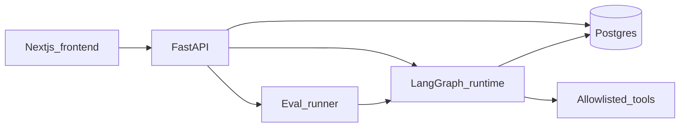

# AI Agent Marketplace

A self-hosted place to create an agent, publish it, clone someone else's configuration, watch a live run, and check it with a small automated suite.

The problem is simple: agent configs usually live in scattered notebooks. This app keeps the prompt, model, tools, and step limit as an immutable version, then lets another user install that version as a draft.

## Architecture



One shared LangGraph runs every agent. `load_config` reads the pinned version, `agent` calls the model or the offline responder, and `tools` runs only the allowlisted names on that version. The loop stops when the model finishes or `max_steps` is hit. Each chat uses `config.configurable.thread_id`. Production checkpoints use `PostgresSaver`.

Allowlisted tools:

- `calculator` — arithmetic through a safe AST, not Python `eval`
- `clock` — current UTC time
- `notes` — the signed-in user's note rows
- `knowledge_search` — keyword search over seeded documents

There is no user-supplied Python and no live payment flow. Install and clone are free. Each run stores latency, status, step count, and estimated tokens.

## Quickstart

Copy the example env, then start Postgres, the API, and the web app:

```powershell
copy .env.example .env
docker compose up --build
```

- Web: http://localhost:3000
- API docs: http://localhost:8000/docs
- Health: http://localhost:8000/health
- Ready (database ping): http://localhost:8000/ready

The API container runs Alembic, seeds the catalog, then starts uvicorn. The web container runs `next start`.

### Seed login

| Email | Password |
| --- | --- |
| demo@example.com | demo-password |

The catalog starts with four published agents: Research summarizer, Support triage, Meeting notes, and Calculator tutor. Each has three automated cases.

Set `OPENAI_API_KEY` and `USE_LLM=true` when you want real model calls. With `USE_LLM=false` the runtime uses a deterministic local responder so demos and tests work without a key.

## Stack

- `frontend/` — Next.js App Router and TypeScript. SSE chat uses `fetch` and a stream reader. `NEXT_PUBLIC_API_URL` points at the API.
- `backend/` — FastAPI, SQLAlchemy, Alembic, PostgreSQL 16, LangGraph.
- JWT login. JSON request logs include request id, route, status, and latency.

## Tests

API tests run against SQLite so they do not need Docker. The application path for Postgres and `PostgresSaver` stays in place; the in-memory checkpointer is selected only when `DATABASE_URL` starts with `sqlite`.

```powershell
python -m pip install -r backend/requirements.txt
$env:DATABASE_URL = "sqlite://"
$env:USE_LLM = "false"
$env:JWT_SECRET = "test-secret-for-local-pytest-only"
pytest
```

Web check:

```powershell
cd frontend
npm ci
npm run lint
npm run build
```

## Limitations

- No billing, payouts, or paid installs.
- Offline mode does not call a model. It follows the user text to one allowlisted tool.
- Knowledge search only sees the seeded documents. It does not crawl the web.
- Checkpoints in production need Postgres. The test settings do not replace that design.
- The seed password is a local demo value. Change `JWT_SECRET` before any shared deployment.
